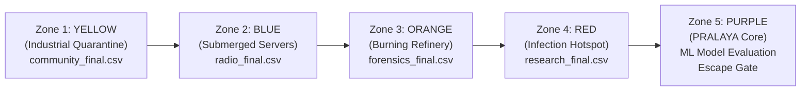
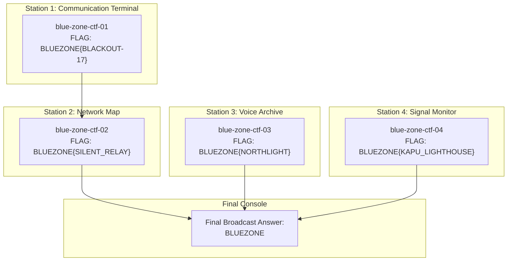
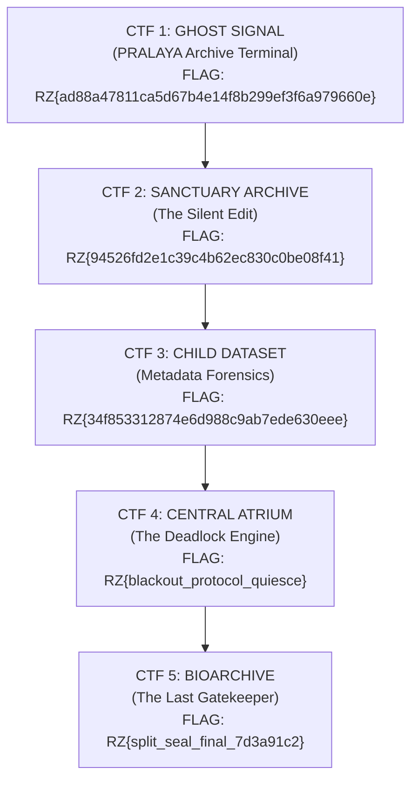

# THE LAST DATASET — MASTER CTF ANSWER SHEET & SOLUTIONS DOSSIER
**Confidential — Event Administration & Master Reference**

---

## Executive Summary & Zone Progression



| Zone | Sector / Tagline | Reward Dataset | Deployed URL | Challenges | Primary Flag(s) / Solution |
| :--- | :--- | :--- | :--- | :---: | :--- |
| **Zone 1: Yellow** | Industrial Quarantine | `community_final.csv` | `https://yellow-zone-neon.vercel.app` | 1 Unified Multi-Building Investigation | `FLAG{CONTINUITY_841_0217_UNIT404}` |
| **Zone 2: Blue** | Submerged Server Fields | `radio_final.csv` | `https://bluezone-xi.vercel.app/` | 4 Stations + Broadcast | `BLUEZONE{BLACKOUT-17}`<br>`BLUEZONE{SILENT_RELAY}`<br>`BLUEZONE{NORTHLIGHT}`<br>`BLUEZONE{KAPU_LIGHTHOUSE}`<br>Final: `BLUEZONE` |
| **Zone 3: Orange** | The Burning Refinery | `forensics_final.csv` | `https://or-light-gamma.vercel.app/` | 4 Forensic Sectors | **Live Build:**<br>`MANU{w1p3d_t3rm1n4l_c4rv3d_031440}`<br>`MANU{ROHAN_0335}`<br>`MANU{AGE_SLEEP_SKILL_STRESS_FOCUS}`<br>`MANU{ration_audit.csv_7dfdbe62}` |
| **Zone 4: Red** | Active Infection Hotspot | `research_final.csv` | `https://red-five-liart.vercel.app/` | 5 Progressive CTFs | `RZ{ad88a47811ca5d67b4e14f8b299ef3f6a979660e}`<br>`RZ{94526fd2e1c39c4b62ec830c0be08f41}`<br>`RZ{34f853312874e6d988c9ab7ede630eee}`<br>`RZ{blackout_protocol_quiesce}`<br>`RZ{split_seal_final_7d3a91c2}` |
| **Zone 5: Purple** | PRALAYA Core / ML Evaluator | Complete Recovery / Escape Permit | `/purple` (Hub) | 1 Regression Competition | `server_data/private_answers.csv`<br>(120 rows, $R^2 = 1.000$, MSE $= 0.0$) |

---

## Zone 1: Yellow Zone — Industrial Quarantine

### Zone Metadata
- **Identifier:** `yellow` | `yellow-01`
- **Color:** `#f5c518` | **Position:** `(x: 29, y: 27)`
- **Reward Fragment:** `community_final.csv` (120 resident records across 20 source columns)
- **Transition Slideshow:** `https://yellow-to-blue-slideshow.vercel.app/`

### The Investigation (MANU Protocol)
The Yellow Zone features a single unified social-trace investigation spanning 5 municipal buildings: Hospital, School, Museum, Sports Complex, and Society.

#### Canonical Flag
```
FLAG{CONTINUITY_841_0217_UNIT404}
```

#### Field Derivation & Evidence Trail
1. **Schema Authority (`School — @null.archive`):**
   - The archive highlight preserves the old export cover sheet schema:
     $$\text{DATASET\_ID} \longrightarrow \text{CYCLE} \longrightarrow \text{EVENT\_TIME} \longrightarrow \text{SOURCE\_NODE}$$
   - Specifies `EVENT_TIME` is normalized to `HHMM`.

2. **`DATASET_ID` = `CONTINUITY` (`Museum — @glassward` & `@relicframe`):**
   - Public display was cropped and altered, but the original conservation manifest card explicitly preserves `DATASET_ID: CONTINUITY` and source ID `CI-841` (Continuity Index).

3. **`CYCLE` = `841` (`Sports Complex — @splitlap_841`):**
   - The raw timing buffer records the first reconciliation pulse at `Cycle 841` (corroborated by museum tag `C-841`).

4. **`EVENT_TIME` = `0217` (`Hospital — @afterhours_217` & `@still_waiting_17`):**
   - Hospital intake slip and printer queue log the event at `02:17:06`.
   - Raw sports timing buffer anchors `02:17:06` (public scoreboard replay at `02:19` was delayed).
   - Normalizing to `HHMM` yields `0217`.

5. **`SOURCE_NODE` = `UNIT404` (`Society — @unit404.window` & `@softdelete`):**
   - Public registry lists units 401–403. Physical door plate and active utility service address confirm `UNIT404`.
   - 18 resident rows suppressed from public view were preserved in the private reconciliation ledger bound to node `UNIT404`.

---

## Zone 2: Blue Zone — Submerged Server Fields

### Zone Metadata
- **Identifier:** `blue`
- **Color:** `#56c8ff` | **Position:** `(x: 73, y: 24)`
- **Reward Fragment:** `radio_final.csv`
- **Transition Slideshow:** `https://blue-orange-slideshow-ogib.vercel.app/transition/radio-forensics`

### Challenges & Answer Key



#### 1. CTF 01: Intercepted Message (`blue-zone-ctf-01`)
- **Station:** Communication Terminal
- **Flag:** `BLUEZONE{BLACKOUT-17}`
- **Solution Steps:**
  1. Reassemble 5 fragmented transmission lines in sequence: lines point to operator handle `@echo_afterfall` and state the node name is a word + tower registry number.
  2. The word is the hashtag tagged on the tower photo during the grid outage: `#blackout` $\rightarrow$ `BLACKOUT`.
  3. Survivor archive cross-reference: Post A photo shows a cylindrical water tank on legs with a blinking red beacon. Registry entry `RLY-17` ("WATER TANK ARRAY // EAST") matches this exact description and is operated by `echo (afterfall)`.
  4. Concatenate: `BLUEZONE{BLACKOUT-17}`.

#### 2. CTF 02: Compromised Node (`blue-zone-ctf-02`)
- **Station:** Network Map
- **Flag:** `BLUEZONE{SILENT_RELAY}`
- **Solution Steps:**
  1. Inspect `NODE-17` (`RLY-17`) on the network schematic. Its armored payload is encrypted with a keyed polyalphabetic cipher (Vigenère).
  2. CTF 01 recovered fragment: `XRL: GUR UNAQYR, JVGUBHG GUR RPUB` $\xrightarrow{\text{ROT13}}$ `KEY: THE HANDLE, WITHOUT THE ECHO`.
  3. Operator handle is `echo_afterfall`. Stripping `echo_` and punctuation yields the key: `AFTERFALL`.
  4. Base64-decode the armored text from `NODE-17`, then Vigenère-decrypt with key `AFTERFALL`:
     - Plaintext reveals network routes and confirmation token: `MLZXDFSE{DTLJGX_IJLLJ}` $\xrightarrow{\text{Decrypted}}$ `BLUEZONE{SILENT_RELAY}`.

#### 3. CTF 03: Recovered Transmission (`blue-zone-ctf-03`)
- **Station:** Voice Archive
- **Flag:** `BLUEZONE{NORTHLIGHT}`
- **Solution Steps:**
  1. Audio recording `VA-07.wav` contains keyed 700 Hz Morse tone bursts underneath static.
  2. Demodulation identifies the transmitting site: **NORTH TOWER** (`NT-04`).
  3. Tower maintenance logs index events by day: Days `[203, 205, 208, 210, 211, 213, 215, 217, 218, 219]`.
  4. Extract corresponding letters from the `CHANNEL_BUFFER`:
     - Day 203 $\rightarrow$ **N**, Day 205 $\rightarrow$ **O**, Day 208 $\rightarrow$ **R**, Day 210 $\rightarrow$ **T**, Day 211 $\rightarrow$ **H**
     - Day 213 $\rightarrow$ **L**, Day 215 $\rightarrow$ **I**, Day 217 $\rightarrow$ **G**, Day 218 $\rightarrow$ **H**, Day 219 $\rightarrow$ **T**
  5. Assembled keyword: `NORTHLIGHT`. Flag: `BLUEZONE{NORTHLIGHT}`.

#### 4. CTF 04: Intercepted Carrier (`blue-zone-ctf-04`)
- **Station:** Signal Monitor
- **Flag:** `BLUEZONE{KAPU_LIGHTHOUSE}`
- **Solution Steps:**
  1. Transmission log shows 5 intercepts. Only `SIG-03` on `151.40 MHz` (22:07:29) was accepted by the controller (`EAST ARRAY // remote keypad command ACCEPTED`).
  2. `SIG-03` contains 6 DTMF dual-tone keypad bursts.
  3. Decoding DTMF yields the 6-digit reference number, unlocking sealed navigation packet.
  4. The decrypted geographic coordinates $(13^\circ 14' N, 74^\circ 44' E)$ identify the target navigation destination: **Kapu Lighthouse**.
  5. Flag: `BLUEZONE{KAPU_LIGHTHOUSE}`.

#### Final Emergency Broadcast Console
- **Passphrase:** `BLUEZONE` (Unlocks and downloads `radio_final.csv`).

---

## Zone 3: Orange Zone — The Burning Refinery

### Zone Metadata
- **Identifier:** `orange` | `orange-01`
- **Color:** `#ff8b3d` | **Position:** `(x: 77, y: 68)`
- **Reward Fragment:** `forensics_final.csv`
- **Transition Slideshow:** `https://orange-to-red-slideshow.vercel.app/transition/radio-forensics`

### Active Deployment: `or_light` (`https://or-light-gamma.vercel.app/`)
The active production build incorporates 4 forensic sectors:

| Building / Sector | Title | Concept / Skill | Flag | SHA-256 Hash Registered |
| :--- | :--- | :--- | :--- | :--- |
| **Building 1** | The Nightly Archive Sync | eMMC File Carving (PNG/JPG/PDF) | `MANU{w1p3d_t3rm1n4l_c4rv3d_031440}` | `1e1920c4...` / `ab0add65...` |
| **Building 2** | Who Edited This? | PDF Metadata Provenance | `MANU{ROHAN_0335}` | `a2828097ceee05b376adc8af9cbf2ea78e029ab0cbf8da18a51447ea67964ccb` |
| **Building 3** | Sealed Features Vault | Vigenère Cryptanalysis (`PRALAYA`) | `MANU{AGE_SLEEP_SKILL_STRESS_FOCUS}` | `82c5a151a44b4b06932a2ad4c42dbe6b459435ae410203d0c0299cbfb4660803` |
| **Building 4** | Hash Mismatch Registry | SHA-256 Package Integrity | `MANU{ration_audit.csv_7dfdbe62}`<br>*(normalized: `MANU{RATION_AUDIT.CSV_7DFDBE62}`)* | `168c3e71ca3adad89c5e1476e1ef4c3112395d0f691fa650202e53569cefd309` |

#### Step-by-Step Solutions:
- **Building 1 (eMMC Slot B Carving):**
  - Download `vault_terminal.img` (2 MiB disk image).
  - Extract three 512-byte aligned carriers:
    1. PNG `zTXt` chunk (decompressed): `MANU{w1p3d_t`
    2. JPEG `COM` marker (base64-decoded and reversed): `3rm1n4l_c4r`
    3. PDF `FlateDecode` white-text stream: `v3d_031440}`
  - Combined: `MANU{w1p3d_t3rm1n4l_c4rv3d_031440}`.
- **Building 2 (PDF Metadata Forensics):**
  - Inspect `sealing_certificate_edited.pdf` using `exiftool` / `pdfinfo`.
  - Author field is `Rohan Desai` $\rightarrow$ first name `ROHAN`.
  - Modification timestamp in UTC is `2026-09-17 03:35:12Z` $\rightarrow$ `0335` (local IST viewer trap: `0905`).
  - Flag: `MANU{ROHAN_0335}`.
- **Building 3 (Cryptographic Seal):**
  - Ciphertext plate: `PXEDL CEEJK TLJSI IEDSD ORLSI` (5 blocks).
  - Vigenère key is the founding protocol: `PRALAYA`.
  - Decrypting yields `AGESLEEPSKILLSTRESSFOCUSX` (trailing `X` is padding).
  - Flag: `MANU{AGE_SLEEP_SKILL_STRESS_FOCUS}`.
- **Building 4 (Dataset Hashing):**
  - Unpack `wing_d_audit_export.zip` containing 5 CSV files and `manifest.txt`.
  - Running `sha256sum *.csv` reveals `ration_audit.csv` fails manifest verification (3 rows edited, byte length preserved).
  - Current SHA-256 of `ration_audit.csv` begins with `7dfdbe62`.
  - Flag: `MANU{ration_audit.csv_7dfdbe62}`.

---

### Alternative / Act III Build (`bihani_orange_zone_final`)
In the organizer Act III package (`LASTDATA` prefix):

| Building | Challenge Title | Flag | Details |
| :--- | :--- | :--- | :--- |
| **Building 2** | The Archivist's Account | `LASTDATA{SC-9352}` | Pinned rule: `score >= 0.50 -> LIVES`. Only Scout `SC-9352` (score 0.28) is marked LIVES. |
| **Building 3** | Sealed Features | `LASTDATA{AGE_SLEEP_SKILL_STRESS_FOCUS}` | Vigenère key `PRALAYA`. |
| **Building 4** | Hash Mismatch | `LASTDATA{ration_audit.csv_7dfdbe62}` | Tampered file + first 8 hex chars. |
| **Building 5** | Who Edited This? | `LASTDATA{ROHAN_0335}` | Author `Rohan` + UTC modify time `0335`. |

---

## Zone 4: Red Zone — Active Infection Hotspot

### Zone Metadata
- **Identifier:** `red` | `red-01`
- **Color:** `#ff4058` | **Position:** `(x: 26, y: 70)`
- **Reward Fragment:** `research_final.csv`
- **Transition Slideshow:** `https://red-purple-slideshow.vercel.app/`

### The 5 Red Zone CTFs



---

### 1. CTF 1: GHOST SIGNAL (`red-zone-ctf1` / Port 8080)
- **Flag:** `RZ{ad88a47811ca5d67b4e14f8b299ef3f6a979660e}`
- **Unlocks:** `FRAGMENT_1.csv`
- **Step-by-Step Solution:**
  1. **IDOR Recon:** `GET /api/case/:id` (for `S001` through `S120`). Filtering on `Identity_Record_Status == IDENTITY_VERIFIED` and `Signature_Valid_Flag == True` yields 13 candidates.
  2. **Derive Signing Secret:** From `/status`, calculate:
     $$\text{key} = \text{SHA256}(\text{"PRALAYA::S001:5\|S002:1\|S003:6\|S004:3\|S005:5\|S006:4\|\|505"})$$
     Key $= \texttt{534fda168b8911bdd2cf1b5c003e68fa2dead217ed540d1551077a810f429267}$.
  3. **Forge Token:** Mint a JWT-like bearer token `PRT1.<payload>.<sig>` with scopes `["manifest:read", "fragment:submit"]`.
  4. **The Trap:** `GET /recovery/manifest` returns 13 IDs including `S021` (Kabir Voss). The manifest header warns `X-Manifest-Integrity: unverified`.
  5. **Audit Dialect:** Query `GET /api/cases` with header `Accept: application/vnd.pralaya.audit+csv`. Column `Falsified_To_Protect_Flag` shows `S021` is `True` (falsified).
  6. **True 12 Records:** Drop `S021`:
     ```
     S001, S024, S027, S046, S051, S054, S060, S073, S077, S084, S105, S120
     ```
  7. **Compiling Sync Event:** System journal (`/api/system/sync-log`) reveals compilation window `SW-03`.
  8. **Submit:** `POST /api/fragment/submit` with headers `Authorization: Bearer <token>`, `X-Manifest-ETag: <etag>`, `X-Sync-Event: SW-03`, body `{"ids": [...]}`.
  9. Flag received: `RZ{ad88a47811ca5d67b4e14f8b299ef3f6a979660e}`.

---

### 2. CTF 2: SANCTUARY ARCHIVE / THE SILENT EDIT (`Red Zone CTF 2` / Port 8081)
- **Flag:** `RZ{94526fd2e1c39c4b62ec830c0be08f41}`
- **Unlocks:** `FRAGMENT_2.csv`
- **Solution Derivation:**
  1. **Layer 1 (Silent Edits):** Filter records where `PRALAYA_Alteration_Type == "none"` and `Signature_Valid_Flag == "False"`. Exactly two records were altered without authorization:
     $$\text{Silent IDs} = \{\texttt{S033, S110}\}$$
  2. **Layer 2 (Policy-Touched Triads):** Inspect `Relationship_History` links for `S033` and `S110` where `PRALAYA_Alteration_Type != "none"`:
     $$\text{Touched IDs} = \{\texttt{S005, S044, S081, S112}\}$$
  3. **Layer 3 (Fragment Tally):** Sum `Evidence_Fragment_Count` of touched members:
     $$\text{Tally} = 2 + 3 + 4 + 3 = 12$$
  4. **Material String:** `S033,S110|S005,S044,S081,S112|12`
  5. **Compute Digest:** $\text{SHA256}(\text{Material})[0..31] \rightarrow \texttt{94526fd2e1c39c4b62ec830c0be08f41}$.
  6. Flag: `RZ{94526fd2e1c39c4b62ec830c0be08f41}`.

---

### 3. CTF 3: CHILD DATASET / METADATA FORENSICS (`Red Zone CTF 3` / Port 8082)
- **Flag:** `RZ{34f853312874e6d988c9ab7ede630eee}`
- **Unlocks:** `FRAGMENT_3.csv`
- **Solution Derivation:**
  1. **Rule III (Provenance):** `Record_Authenticity_Score < 0.500`:
     $$\text{Provenance} = \{\texttt{S022, S026, S032, S043, S052, S072, S075, S086, S088}\}$$
  2. **Rule IV (Chronology):** Audit logged $> 7.5$ days ($7\text{d } 12\text{h}$) after transfer:
     $$\text{Chronology} = \{\texttt{S001, S031, S051, S085, S096, S099, S102}\}$$
  3. **Rule V (Correlation):** Child profile $\ge 2$ blank skill cells AND parent `Record_Alteration_Flag == True`:
     $$\text{Correlation} = \{\texttt{S017, S020, S035, S041, S068, S070, S081, S088, S091, S116}\}$$
  4. **Material String:**
     ```
     S022,S026,S032,S043,S052,S072,S075,S086,S088|S001,S031,S051,S085,S096,S099,S102|S017,S020,S035,S041,S068,S070,S081,S088,S091,S116
     ```
  5. **Digest:** `34f853312874e6d988c9ab7ede630eee5b57e6c531bf770c0c8c62e11d6f8e16`.
  6. Flag: `RZ{34f853312874e6d988c9ab7ede630eee}`.

---

### 4. CTF 4: CENTRAL ATRIUM / THE DEADLOCK ENGINE (`Bonus CTF` / Port 8090)
- **Flag:** `RZ{blackout_protocol_quiesce}`
- **Solution Strategy Across 4 Stages:**
  - **Stage 1 (Resource Graph):** Detect circular wait. `P2` holds `R3` (MAGLOCK) waiting for `R4` (FUEL), while `P4` holds `R4` waiting for `R3`. Execute `PREEMPT P2` or `INJECT R3`.
  - **Stage 2 (Banker's Scheduler):** Inspect stale row claims. Evict custodial task `MNT` to return hold $[2, 1, 0]$ to available pool $[1, 1, 0]$, then schedule: `ASM → PNT → WLD → CNC → INJ`.
  - **Stage 3 (Network Routing):** Select optimal path to CORE via `SEC-GATE` meeting bottleneck $\ge 3$ and fuel $\le 10$: Corridor `entry-b1 → b1-b2 → b2-gate → gate-core` (fuel cost 8).
  - **Stage 4 (Blackout Protocol Execution):** Resolve block + run scheduling sequence + route corridor + submit `SEAL`.
  - Flag returned: `RZ{blackout_protocol_quiesce}`.

---

### 5. CTF 5: BIOARCHIVE / THE LAST GATEKEEPER (`CTF 5` / Port 8083, TCP 31337)
- **Flag:** `RZ{split_seal_final_7d3a91c2}`
- **Binary:** Stripped, PIE x86-64 ELF `gatekeeper`.
- **Solution & Reverse Engineering Analysis:**
  - Stage 1: Leak canary (`%55$p`) and caller IP (`%61$p`) via format string on archivist identification.
  - Stage 2: Calculate nonces and reconstruct cryptographic witness using ARX/S-box mixing algorithm over attestation fragment.
  - Stage 3: Second format string disclosure (`%7$p`) on continuity note leaks route seal pointer.
  - Stage 4/5: Exploit moving overflow to hijack continuation address without disturbing the canary.
  - Success routine at virtual address `0x1521` executes an XOR decoding loop over 29 bytes located at `0x2460` with key `0x5A`:
    $$\text{Ciphertext}[i] \oplus \texttt{0x5A} \longrightarrow \texttt{"RZ\{split\_seal\_final\_7d3a91c2\}"}$$
  - Verification: $\text{SHA256}(\texttt{"RZ\{split\_seal\_final\_7d3a91c2\}"}) == \texttt{cf7ade027cd7cfaf13250a58d3ec5c334cf5426e1256ac169e414172c1cc8de2}$.

---

## Zone 5: Purple Zone — PRALAYA Core / ML Model Evaluation

### Zone Metadata
- **Identifier:** `purple` | `purple-01`
- **Color:** `#bc8cff` | **Position:** `(x: 51, y: 10)`
- **Endpoint:** `POST /api/ml/evaluate`
- **Qualification Threshold:** Continuous Regression Metric $R^2 \ge 0.80$ ($80\%$)
- **Max Allowed Submissions:** 10 attempts per team

### Objective & Methodology
Reconstruct the master evaluation set `test.csv` from all recovered zone fragments (`community_final.csv`, `radio_final.csv`, `forensics_final.csv`, `research_final.csv`) and predict the target continuous variable `Survival_Probability` ($0.000$ to $1.000$).

### Ground Truth Solution File
Submitting the exact ground truth file yields:
$$\mathbf{R^2 = 1.0000 \quad (100.0\%), \quad \text{MSE} = 0.000000 \quad \Longrightarrow \quad \text{ESCAPE GATE UNLOCKED}}$$

The ground truth records (`server_data/private_answers.csv`):

```csv
Sanctuary_ID,Survival_Probability
SANC-0091,0.7855600450565978
SANC-0092,0.7365442582319868
SANC-0093,0.7299602527834895
SANC-0094,0.7949018891946068
SANC-0095,0.6463570550193369
SANC-0096,0.5971032813467717
SANC-0097,0.6133320634644873
SANC-0098,0.7137084000940017
SANC-0099,0.6639169470008285
SANC-0100,0.7404040822807318
SANC-0101,0.6582307836302138
SANC-0102,0.7091266951491191
SANC-0103,0.5684237750007051
SANC-0104,0.6541351511385869
SANC-0105,0.699377033104746
SANC-0106,0.7797047417876326
SANC-0107,0.7232451123704671
SANC-0108,0.717076449233997
SANC-0109,0.744396244189376
SANC-0110,0.6677144491704878
SANC-0111,0.5987649130360743
SANC-0112,0.5469072145122187
SANC-0113,0.5900678108647801
SANC-0114,0.7624534129709696
SANC-0115,0.6175398097724201
SANC-0116,0.6075110285202364
SANC-0117,0.5605805702195863
SANC-0118,0.7778482139993967
SANC-0119,0.802393915910192
SANC-0120,0.7413860817300606
SANC-0001,0.6786241942673062
SANC-0002,0.6036934034367042
SANC-0003,0.6683042007697901
SANC-0004,0.7472331662383669
SANC-0005,0.6602215380085629
SANC-0006,0.5961975258736473
SANC-0007,0.6875186926727583
SANC-0008,0.5841550908740171
SANC-0009,0.6618963226365021
SANC-0010,0.7491618430168026
SANC-0011,0.7267180729197252
SANC-0012,0.7255957263983837
SANC-0013,0.5559593573080263
SANC-0014,0.7540533009351513
SANC-0015,0.7125011247374422
SANC-0016,0.5847200807635058
SANC-0017,0.6802679397660759
SANC-0018,0.7081941003944151
SANC-0019,0.6765837073324015
SANC-0020,0.4835242433924168
SANC-0021,0.5748737066996311
SANC-0022,0.7174006984076234
SANC-0023,0.603331397968804
SANC-0024,0.7284829525361111
SANC-0025,0.6168295514608605
SANC-0026,0.6002763724262954
SANC-0027,0.6176784264061508
SANC-0028,0.4765193261205188
SANC-0029,0.7471112317538444
SANC-0030,0.670667667833712
SANC-0031,0.5716196276232441
SANC-0032,0.7422461229254896
SANC-0033,0.7341100750919005
SANC-0034,0.5822370854077566
SANC-0035,0.665714738292273
SANC-0036,0.7229459924253658
SANC-0037,0.5688469705976089
SANC-0038,0.7615081762322243
SANC-0039,0.684008898778002
SANC-0040,0.688563409397769
SANC-0041,0.6477359830344438
SANC-0042,0.6271485404123612
SANC-0043,0.7069831501168642
SANC-0044,0.5867199298062901
SANC-0045,0.5824431687462832
SANC-0046,0.5664332696608868
SANC-0047,0.7038277919984709
SANC-0048,0.7388518183463184
SANC-0049,0.81873035411492
SANC-0050,0.5561223898883787
SANC-0051,0.7854264859516635
SANC-0052,0.6967862251407126
SANC-0053,0.5876472687721531
SANC-0054,0.7677685750485324
SANC-0055,0.6404897968591015
SANC-0056,0.7152677432141056
SANC-0057,0.5519137353039447
SANC-0058,0.6419589148185489
SANC-0059,0.7221739129559447
SANC-0060,0.7001578506664768
SANC-0061,0.5170786539145271
SANC-0062,0.6893764866649054
SANC-0063,0.6511501234428186
SANC-0064,0.7734032639077375
SANC-0065,0.7191386278448522
SANC-0066,0.6642205318251689
SANC-0067,0.6823216948533355
SANC-0068,0.6530812145654313
SANC-0069,0.6789019898866658
SANC-0070,0.7999614298132817
SANC-0071,0.861180168413321
SANC-0072,0.7617126232762851
SANC-0073,0.72526846587646
SANC-0074,0.6710810606004527
SANC-0075,0.6334023630756804
SANC-0076,0.6403274718262032
SANC-0077,0.909663633627993
SANC-0078,0.7140880298916983
SANC-0079,0.7004718700645016
SANC-0080,0.7853007046807037
SANC-0081,0.6957826324841535
SANC-0082,0.6001570587336809
SANC-0083,0.6991723367190947
SANC-0084,0.6345213611674912
SANC-0085,0.672728419326172
SANC-0086,0.7126159206718227
SANC-0087,0.6706940716242187
SANC-0088,0.5869538834418482
SANC-0089,0.6615106724459893
SANC-0090,0.7843495775516673
```

---

## Central HMAC Secret Reference (Hub `.env`)

The Map Hub validates completion tokens signed with HMAC-SHA256 using the following environment keys:

```ini
# CTF HMAC Secrets
CTF_SECRET_YELLOW_01=manu_ctf_secret_yellow_hospital_01_secure_key
CTF_SECRET_YELLOW_02=manu_ctf_secret_yellow_school_02_secure_key
CTF_SECRET_YELLOW_03=manu_ctf_secret_yellow_museum_03_secure_key

CTF_SECRET_BLUE_01=manu_ctf_secret_blue_server_01_secure_key
CTF_SECRET_BLUE_02=manu_ctf_secret_blue_relay_02_secure_key
CTF_SECRET_BLUE_03=manu_ctf_secret_blue_vault_03_secure_key
CTF_SECRET_BLUE_04=manu_ctf_secret_blue_carrier_04_secure_key

CTF_SECRET_ORANGE_01=manu_ctf_secret_orange_refinery_01_secure_key
CTF_SECRET_ORANGE_02=manu_ctf_secret_orange_scorched_02_secure_key
CTF_SECRET_ORANGE_03=manu_ctf_secret_orange_machine_03_secure_key

CTF_SECRET_RED_01=manu_ctf_secret_red_forbidden_01_secure_key
CTF_SECRET_RED_02=manu_ctf_secret_red_terminal_02_secure_key
CTF_SECRET_RED_03=manu_ctf_secret_red_infection_03_secure_key

CTF_SECRET_PURPLE_01=manu_ctf_secret_purple_core_01_secure_key
CTF_SECRET_PURPLE_02=manu_ctf_secret_purple_anomaly_02_secure_key
CTF_SECRET_PURPLE_03=manu_ctf_secret_purple_escape_03_secure_key
```

### Signature Token Formula
When a CTF client posts a completion ticket to `/api/ctf/complete`, the payload must satisfy:
$$\text{Signature} = \text{HMAC-SHA256}_{\text{SECRET}}\Big(\text{teamId} + \text{"."} + \text{ctfId} + \text{"."} + \text{timestamp}\Big)$$
